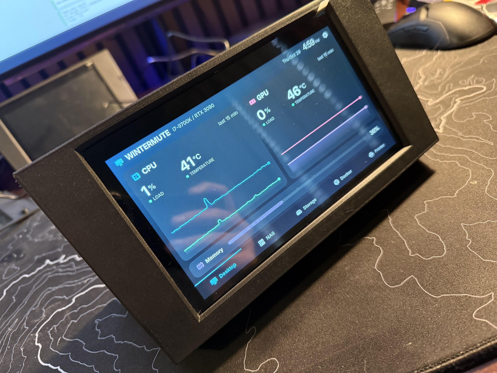
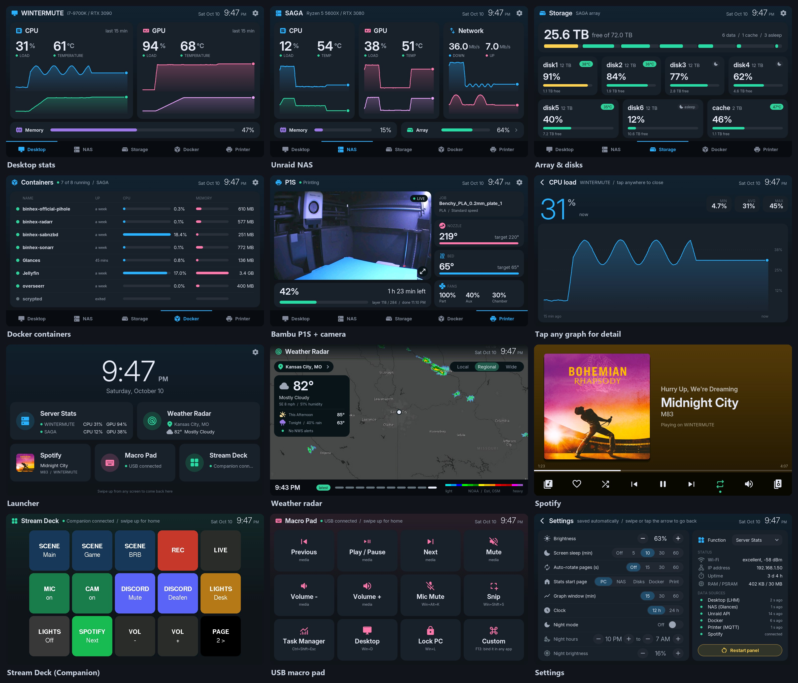
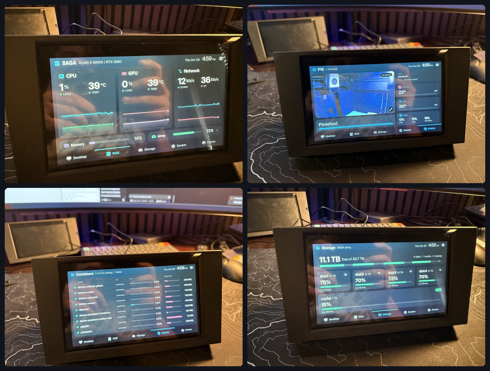
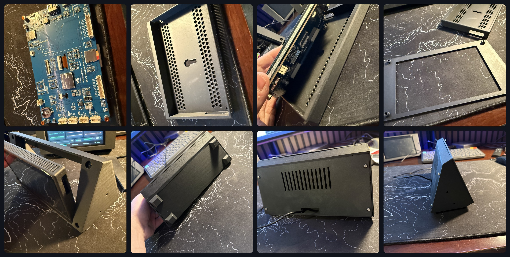

# ServerPanel

A 7" touchscreen for my desk that shows what my homelab is doing: my PC, my Unraid NAS, its Docker containers, and my Bambu 3D printer with its live camera. It also works as a weather radar, a Spotify remote, a Stream Deck and a USB macro pad. The firmware is C++ and runs on a Waveshare ESP32-P4 board. The case is designed in Fusion and 3D printed.

## What it does

*Every screen, rendered on a PC from the same UI code the panel runs (sample data).*

- **Server stats:** CPU and GPU load and temperatures for the PC, plus the NAS's CPU, GPU, network, array, each disk (spun-down disks stay asleep) and every Docker container. The graphs cover the last 15, 30 or 60 minutes. Tap any gauge, disk or container for a full-screen graph.
- **3D printer:** a Bambu P1S's progress, temperatures and fans over its local MQTT, with the chamber camera streaming at about 1 frame a second. It needs no cloud account.
- **Weather radar:** the past hour of NOAA radar looped over a dark map, with current conditions, the forecast and NWS alerts. Pick the place by typing a US ZIP code on the panel.
- **Spotify:** what's playing on any of your devices, with album art, playback controls, seeking, volume, your library, and switching between devices.
- **Stream Deck:** a 5x3 button surface for [Bitfocus Companion](https://bitfocus.io/companion).
- **Macro pad:** a 4x3 grid of keys sent to the PC as a USB keyboard (media keys, shortcuts, F13-F24).
- **Launcher:** a clock plus a tile for each app. Swipe up from any screen to get back to it.
- **Settings on the panel:** what it boots into, brightness, screen sleep, night mode on a schedule, 12/24 h clock, and the status of every data source. Updates install over Wi-Fi.

## Hardware

- Waveshare ESP32-P4-WIFI6-Touch-LCD-7B: ESP32-P4 (dual-core RISC-V, 400 MHz), 32 MB PSRAM, 32 MB flash, 7" 1024x600 MIPI-DSI display, GT911 capacitive touch, and an ESP32-C6 for Wi-Fi 6.
- A 3D printed case and stand (PLA), M3 heat-set inserts and screws.
- A USB-C cable for power, and a USB-A to USB-A cable to the PC for the macro pad.

## The build

The board sits in a printed case with vent grids: [Waveshare ESP32-P4-WIFI6-Touch-LCD-7B case](https://www.printables.com/model/1796723-waveshare-esp32-p4-wifi6-touch-lcd-7b) from Printables (CC BY-NC-ND 4.0, so it isn't included here). The case slides into a wedge stand from the front, a bezel screws on over it, and an L-shaped cover closes the bottom and back. The stand leans the screen back to 65 degrees and covers the USB plugs and cables, which leave through a slot at the back.

Each enclosure is made by a Fusion Python script that builds the model from constants at the top of the file and writes the STLs, so changing a size means editing a number and running it again. Its asserts catch fits that break, such as blocked USB ports or vents hitting bosses.

- [cad/CaseStand](cad/CaseStand): the stand, bezel and cover in the photos. The script needs the case model above: download its STL into that folder as `p4_case.stl`.
- [cad/PanelEnclosure](cad/PanelEnclosure): a larger design for four panels on a curved arc under an 800R ultrawide monitor. See [cad/README.md](cad/README.md).

## The software

C++ on the Arduino framework (on ESP-IDF), built with PlatformIO. Drawing uses [LovyanGFX](https://github.com/lovyan03/LovyanGFX), with the Inter font and Material Symbols icons turned into anti-aliased bitmap fonts by a Python script.

| File | Job |
|---|---|
| `src/main.cpp` | Hardware and network: display and touch drivers, a background task that polls the PC and NAS, settings saved in flash, night mode, Wi-Fi updates, USB keyboard |
| `src/ui.cpp` | Every screen and all navigation. It has no hardware code, so it also builds on a PC |
| `src/printer.cpp` | The printer's MQTT client and camera stream |
| `src/radar.cpp` | Map tiles, radar frames and weather downloads |
| `src/spotify.cpp` | The Spotify Web API client |
| `src/companion.cpp` | The Bitfocus Companion client |
| `tools/preview.cpp` | Renders every screen to PNG on a PC with SDL2, the quick way to check a UI change without flashing |

Each network client runs in its own FreeRTOS task, and the display redraws once a second from a copy of the shared data. The screen is double-buffered, so frames swap without tearing.

Data sources:
- PC: [LibreHardwareMonitor](https://github.com/LibreHardwareMonitor/LibreHardwareMonitor)'s web server
- NAS: [Glances](https://github.com/nicolargo/glances) for CPU, GPU, network and containers; the Unraid API for the array and disks
- Printer: Bambu's LAN MQTT (TLS) and camera stream
- Weather: NOAA MRMS radar, api.weather.gov, Esri map tiles
- Spotify Web API and the Companion Satellite API

## Problems solved along the way

- **Internal RAM.** The chip has 32 MB of PSRAM but only about 768 KB of fast internal RAM. Each TLS connection (printer, camera, radar, Spotify) used about 35 KB of it, and with three open at once the link to the Wi-Fi chip locked up until a reboot. TLS memory now lives in PSRAM, so do the JSON parsers, and the camera, radar and Spotify take turns connecting.
- **The watchdog.** The chip reboots if a task blocks the processor for 5 seconds. Slow network reads and image decoding tripped it, the radar's map labels worst of all. The fixes were short timeouts, idle priority for the image tasks, building the map layers once instead of every frame, and a camera that skips stale frames. Crashes save a core dump to flash, so they can be traced afterward.
- **Flash writes glitch the display.** Writing flash stalls the PSRAM the screen draws from, so Wi-Fi doesn't save to flash and settings save 3 seconds after the last change.
- **Touch.** The touch panel is mounted upside down relative to the display, and the touch chip drops out mid-press, so a gesture only ends after 80 ms without touch.
- **The SD card shares a bus with Wi-Fi.** Writing to the card during big downloads locked up the Wi-Fi link, so uploads arrive in 1 MB pieces that get written between transfers.
- **Spotify's 2026 API changes**: Liked Songs moved to new endpoints, and a developer app now needs Premium.

## Set it up yourself

[docs/SETUP.md](docs/SETUP.md) covers the PC and NAS software, each optional app, and flashing. Copy `src/config.example.h` to `src/config.h` and `ota.example.ini` to `ota.ini` and fill them in. Both copies are git-ignored, so your passwords and keys stay out of the repository.

More detail: [docs/DESIGN.md](docs/DESIGN.md) (screens, look, data sources, architecture) and [docs/STATUS.md](docs/STATUS.md) (current state).
